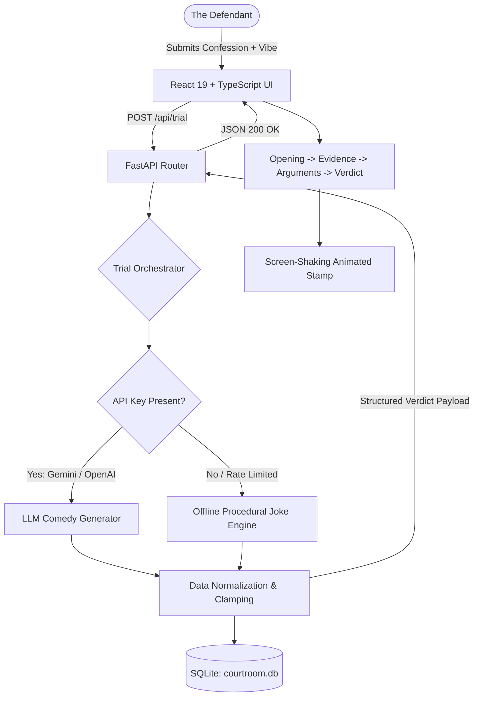

# Courtroom of Stupid Decisions

<div align="center">

```
  ____                  _                              __   ____  _              _     _   ____            _     _
 / ___|___  _   _ _ __ | |_ _ __ ___   ___  _ __ ___    \ \ / / / / /___ _   _  __| |   / | |  _ \  ___  ___(_)___(_) ___  _ __  ___
| |   / _ \| | | | '__|| __| '__/ _ \ / _ \| '_ ` _ \    \ V / / / // __| | | |/ _` |   | | | | | |/ _ \/ __| / __| |/ _ \| '_ \/ __|
| |__| (_) | |_| | |   | |_| | | (_) | (_) | | | | | |    | | / / / \__ \ |_| | (_| |   | | | |_| |  __/ (__| \__ \ | (_) | | | \__ \
 \____\___/ \__,_|_|    \__|_|  \___/ \___/|_| |_| |_|    |_|/_/_/  |___/\__,_|\__,_|   |_| |____/ \___|\___|_|___/_|\___/|_| |_|___/
```

**Where your most embarrassing blunders, 3 AM intrusive thoughts, and unhinged life choices get dragged in front of a fictional jury.**

[](https://python.org)
[](https://fastapi.tiangolo.com)
[](https://react.dev)
[](https://www.typescriptlang.org)
[](https://vitejs.dev)
[](https://tailwindcss.com)
[](https://sqlite.org)
[](LICENSE)

[The Lowdown](#the-lowdown) • [The Courtroom Clowns](#the-courtroom-clowns) • [Crime Categories](#the-stupidity-index--crime-categories) • [Tech Stack](#why-did-we-build-this-stack) • [Quick Start](#quick-start-run-this-disaster) • [API Reference](#api-reference-for-the-nerds) • [Config](#environment--secrets)

</div>

---

## The Lowdown

Let us be completely honest with each other: you have done some genuinely unhinged stuff. 

- You waved back with full main-character energy at someone who was looking at their dog behind you, and instead of taking the L, you morphed it into a full-body yoga stretch.
- You rehearsed a heated argument in the shower for forty-five minutes, hit all your talking points, and somehow still lost the debate against yourself.
- The airport TSA agent told you "Have a safe flight" and you replied "You too," instantly sealing your fate as an NPC.
- You typed out a three-paragraph novel to your situationship, stared at it for twenty minutes, deleted it, and sent "k" instead.

**Courtroom of Stupid Decisions** takes your most catastrophic social fumbles and puts them through a full judicial kangaroo court. You confess your sins, pick how aggressively you want to be roasted, and let our procedural trial engine cook you until there is nothing left of your dignity.

> **Zero-Dollar Broke Mode Included:**
> You do not even need an AI API key. If you are down bad and cannot afford OpenAI or Gemini tokens, our offline template engine steps in with hardcoded generational roasts, completely free and offline.

---

## What This App Actually Does

- **The Stand**: You drop your confession into the dock, choose how toxic you want the room to be (Friendly, Brutally Honest, or Unhinged), and submit your case to the docket.
- **Auto-Crime Profiling**: The backend categorizes your blunder into clinical diagnostic terms (e.g., "Aggravated Social Awkwardness", "Premeditated Deadline Destruction", "Texting Under the Influence").
- **Stupidity Severity Meter (1 to 10)**: A scientific, peer-reviewed measurement of exactly how cooked you are.
- **Exhibit Generation**: Synthetic evidence pulled directly from your questionable life choices (Exhibit A: Incident Report, Exhibit B: Incognito Tabs, Exhibit C: Secondhand Embarrassment Witness Logs).
- **Prosecution vs. Defense Yap Session**: Vicky Overkill treats your typo like high treason, while Greg Bumble accidentally enters his grocery list as evidence and proves the prosecution right.
- **Mid-Trial Drama**: Random courtroom interruptions, objection wars over irrelevant sandwiches, and the judge taking a twenty-minute recess to chase a laser pointer.
- **The Gavel Drop**: An animated, screen-shaking verdict stamp (GUILTY, MOSTLY GUILTY, or the rarest outcome in human history, NOT GUILTY).
- **The Sentence**: Absurd punishments designed to haunt you at 3 AM for the next half-decade.
- **The Case Archive**: Every humiliation saved to local SQLite so you can review your rap sheet whenever you feel like your self-esteem is getting too high.
- **Panic Button / Random Generator**: When your brain freezes and you cannot remember your latest L, click the randomize button and let the engine invent a catastrophe for you.

---

## The Courtroom Clowns

| Personnel | Role | Background Check & Vibe |
|---|---|---|
| **Judge Reginald "Randy" Trash-Panda III** | Presiding Judge | A literal North American raccoon wearing an oversized judicial wig. Has zero law degrees, accepts shiny garbage as bribes, nods off during closing arguments, and delivers completely unhinged sentences with extreme prejudice. |
| **Victoria "Vicky" Overkill** | Prosecuting Attorney | Treats every awkward high-five like a felony indictment. Slams manila folders on desks, writes "GOTCHA" in red marker across legitimate receipts, and will object to the concept of breathing if it helps her win rate. |
| **Greg Bumble, Esq.** | Defense Attorney | Down bad, chronically confused, and somehow still licensed to practice law. Means well, but will accidentally submit your deleted search history to the judge and whisper "my bad" while you get handed a five-year sentence. |

---

## The Stupidity Index & Crime Categories

The prosecution files charges under these recognized categories of human malfunction:

- **Social Embarrassment**: Walking into glass doors, tripping on flat pavement, waving at strangers, making eye contact through bathroom stall gaps.
- **Procrastination Olympics**: Starting a semester project at 3:45 AM when it is due at 8:00 AM, cleaning your baseboards instead of studying.
- **Questionable Texting**: Double-texting paragraphs, drunk texting your ex about conspiracy theories, leaving read receipts on for three business weeks.
- **Unnecessary Overthinking**: Spending four hours decoding a three-word text message, simulating 87 worst-case scenarios before asking for extra ketchup.
- **Petty Revenge**: Malicious compliance, leaving passive-aggressive Sticky Notes on communal milk, sabotaging WiFi routers for five minutes of peace.
- **Academic Disasters**: Reading the textbook for the first time while the professor passes out the midterm, putting your name on the group chat and nothing else.
- **General Stupidity**: Actions so devoid of logic that modern science cannot categorize them.

### Verdict Thresholds

```
Severity:   [ 1 ────── 3 ]       [ 4 ────── 6 ]       [ 7 ────── 10 ]
Verdict:     NOT GUILTY          MOSTLY GUILTY            GUILTY
Status:      Suspicious Fluke    Common Skill Issue   Irredeemably Cooked
```

---

## Why Did We Build This Stack?

We built a modern, responsive, high-performance distributed architecture just to tell people their shower arguments are embarrassing:

- **FastAPI (Python 3.12)**: Asynchronous, blisteringly fast, type-safe API engine. Handles validation, case generation, and database sessions without breaking a sweat.
- **SQLAlchemy 2.0 & SQLite**: Zero-maintenance embedded relational database. Your confessions live locally in `courtroom.db`. No cloud data leaks, no corporate surveillance of your awkward moments.
- **React 19 & TypeScript 6**: Strict type contracts, zero runtime bugs, modern component state.
- **Vite 8**: Sub-second Hot Module Replacement because waiting more than 50 milliseconds for a comedy app to reload is unacceptable.
- **Tailwind CSS v4 + Obsidian & Gold Theme**: Noir courtroom vibes, dark glassmorphism, animated stamps, parchment-style transcripts.
- **Lucide Icons & Framer Motion**: Clean vector iconography and micro-animations that give weight to every gavel strike.
- **Google Gemini & OpenAI Integration**: Pluggable AI generation for context-aware roasts, backed by our deterministic offline fallback engine.

---

## Architecture: How the Roast Pipeline Works



---

## Repository Layout

```
Courtroom of Stupid Decisions/
├── README.md                  # This exact document
├── file.md                    # The original product manifesto
├── start.ps1                  # One-click Windows launch script
├── .gitignore                 # Keeps your node_modules and .env out of git
│
├── backend/                   # Python FastAPI Backend
│   ├── main.py                # FastAPI entry, CORS middleware, table creation
│   ├── config.py              # Pydantic Settings reading .env
│   ├── database.py            # SQLAlchemy engine, session maker, Case model
│   ├── schemas.py             # Pydantic models for incoming & outgoing payloads
│   ├── courtroom.db           # SQLite database file (created on boot)
│   ├── requirements.txt       # Python package list
│   ├── .env.example           # Configuration template
│   │
│   ├── engine/                # Core Comedy Intelligence
│   │   ├── orchestrator.py    # Coordinates AI vs template fallbacks
│   │   ├── ai_generator.py    # Prompt chains for Gemini & OpenAI
│   │   └── templates.py       # Offline weighted randomness & pre-written roasts
│   │
│   └── routers/
│       └── trials.py          # REST endpoints (/api/trial, /api/cases, etc.)
│
└── frontend/                  # React 19 Frontend
    ├── package.json           # npm dependencies
    ├── vite.config.ts         # Vite build configuration
    ├── index.html             # HTML root shell
    │
    └── src/
        ├── main.tsx           # React DOM root mounting
        ├── App.tsx            # Main controller, header, active view router
        ├── index.css          # Courtroom design tokens, dark themes, stamp keyframes
        ├── api.ts             # Axios service layer
        ├── types.ts           # TypeScript interfaces for trial data
        │
        └── components/
            ├── ConfessionForm.tsx  # Confession textarea, radio picks, randomizer
            ├── TrialView.tsx       # Interactive trial steps, evidence cards, gavel stamp
            └── CaseHistory.tsx     # Docket list, delete actions, past verdict inspect
```

---

## Quick Start: Run This Disaster

### Requirements
- **Python**: 3.10 or higher (`python --version`)
- **Node.js**: 18.0 or higher (`node --version`)
- A working sense of humor and at least one embarrassing memory.

---

### Method 1: The One-Click Way (Windows PowerShell)

Just run this from the project root:

```powershell
.\start.ps1
```

This launches the backend on port 8000 and the frontend on port 5173 in parallel terminals.

---

### Method 2: The Manual Way

#### Step 1: Fire Up the Backend

```powershell
cd backend

# Setup your virtual environment
python -m venv venv
.\venv\Scripts\activate

# Install the dependencies
pip install -r requirements.txt

# Create your config file
copy .env.example .env

# Run the API server
uvicorn main:app --reload --port 8000
```

The backend is now live at `http://localhost:8000`. Interactive docs are at `http://localhost:8000/docs`.

#### Step 2: Spin Up the Frontend

Open a new terminal window:

```powershell
cd frontend

# Install packages
npm install

# Start Vite dev server
npm run dev
```

Open your browser and navigate to `http://localhost:5173`. Step up to the stand.

---

## Environment & Secrets

Edit `backend/.env` to configure your AI provider of choice:

```ini
# Pick one provider: "gemini" or "openai"
AI_PROVIDER=gemini

# Google Gemini (Free tier available at https://aistudio.google.com)
GEMINI_API_KEY=your_key_here
AI_MODEL=gemini-1.5-flash

# Or OpenAI (https://platform.openai.com)
OPENAI_API_KEY=your_key_here
# AI_MODEL=gpt-4o-mini

# Database and CORS
DATABASE_URL=sqlite:///./courtroom.db
CORS_ORIGINS=["http://localhost:5173","http://localhost:3000"]
```

> **Pro Tip:**
> If you leave both API keys empty, the system does not crash or complain. It silently falls back to the template engine so you can still roast your friends without spending a single cent.

---

## API Reference (For the Nerds)

Full interactive OpenAPI documentation is generated automatically at:
- **Swagger UI**: `http://localhost:8000/docs`
- **ReDoc**: `http://localhost:8000/redoc`

### Route Summary

| Method | Route | Description | Payload / Query |
|---|---|---|---|
| `POST` | `/api/trial` | Process a confession and return the full trial | JSON: `confession`, `personality` |
| `GET` | `/api/cases` | Fetch all historical cases from the docket | `?skip=0&limit=20` |
| `GET` | `/api/cases/{case_id}` | Retrieve complete details of a specific case | Path parameter: `case_id` (UUID) |
| `DELETE` | `/api/cases/{case_id}` | Purge an embarrassing record from history | Path parameter: `case_id` (UUID) |
| `GET` | `/api/confession/random` | Return a pre-packaged stupid confession | None |
| `GET` | `/api/health` | Check if the court is currently in session | None |

### Sample Trial Payload

#### Request:
`POST /api/trial`

```json
{
  "confession": "I spent 40 minutes rehearsing an argument in the shower, brought it up at dinner, stuttered on the first sentence, and apologized.",
  "personality": "unhinged"
}
```

#### Response (200 OK):

```json
{
  "id": "7f8b9c2a-45d1-4e89-b123-9876543210ab",
  "confession": "I spent 40 minutes rehearsing an argument in the shower, brought it up at dinner, stuttered on the first sentence, and apologized.",
  "category": "unnecessary_overthinking",
  "personality": "unhinged",
  "judge_name": "Judge Reginald 'Randy' Trash-Panda III",
  "prosecutor_name": "Victoria 'Vicky' Overkill",
  "defense_name": "Greg Bumble, Esq.",
  "evidence": [
    {
      "title": "Water Bill Exhibit",
      "description": "City records showing 40 gallons of hot water consumed solely to lose an imaginary debate against tile grout.",
      "exhibit_label": "Exhibit A"
    },
    {
      "title": "The Immediate Retreat",
      "description": "Eye witnesses confirm defendant muttered 'nevermind sorry' before anyone had even responded.",
      "exhibit_label": "Exhibit B"
    }
  ],
  "prosecution_arguments": [
    "Your Honor, the defendant committed premeditated vocal treason against their own vocal cords!",
    "This was not a conversation. This was a preemptive unconditional surrender."
  ],
  "defense_arguments": [
    "Your Honor, my client was simply testing the acoustics of the dining room!",
    "Is it really a crime to apologize for existing? Actually, wait, don't answer that."
  ],
  "courtroom_events": [
    {
      "type": "event",
      "character": "Judge Randy",
      "description": "The judge climbed onto the desk, knocked over the water pitcher, and hissed at the court reporter."
    }
  ],
  "verdict": "GUILTY",
  "sentence": "You are sentenced to narrate every decision you make in a formal British accent for six months.",
  "severity_score": 9,
  "created_at": "2026-10-18T10:30:00Z"
}
```

---

## How to Add Your Own Jokes & Crimes

Want to expand the courtroom's repertoire? It takes five minutes:

1. **Add new crime templates**: Open [templates.py](file:///c:/Users/ASUS/OneDrive/Desktop/MY%20FUCKED%20UP%20LIFE/Courtroom%20of%20Stupid%20Decisions/backend/engine/templates.py) and add new keyword mappings under `CATEGORIES`.
2. **Add absurd sentences**: Append your favorite ridiculous punishments to the `SENTENCES` list in the same file.
3. **Add courtroom chaos**: Drop new objection and interruption scripts into the `EVENTS` array.
4. **Tweak AI Prompts**: Head over to [ai_generator.py](file:///c:/Users/ASUS/OneDrive/Desktop/MY%20FUCKED%20UP%20LIFE/Courtroom%20of%20Stupid%20Decisions/backend/engine/ai_generator.py) to crank up the sarcasm level in the system instructions.

---

## Roadmap

- [ ] **Exportable Verdict Cards**: Generate shareable PNG cards via Python Pillow so you can post your L on social media.
- [ ] **Soundboard Integration**: Dramatic gavel thuds, Phoenix Wright style OBJECTION stingers, and raccoon chittering audio.
- [ ] **Public Shame Gallery / Jury Voting**: Let random strangers on the web vote on whether your confession was actually guilty or justified.
- [ ] **Multiplayer Roast Offs**: Two users enter the same petty argument, present their cases, and let Judge Randy pick who was in the wrong.

---

## Legal Notice

All verdicts, sentences, character dialogues, and criminal classifications produced by this software are entirely fictional and hold zero legal authority in any earthly court of law. Judge Reginald "Randy" Trash-Panda III is an uncertified wild animal prone to rummaging through compost bins. The developers accept no liability for bruised egos, sleepless nights, or sudden recollections of that awkward thing you did in middle school.

---

<div align="center">

Built for anyone who has ever said "you too" to a waiter.

[Back to Top](#courtroom-of-stupid-decisions)

</div>
