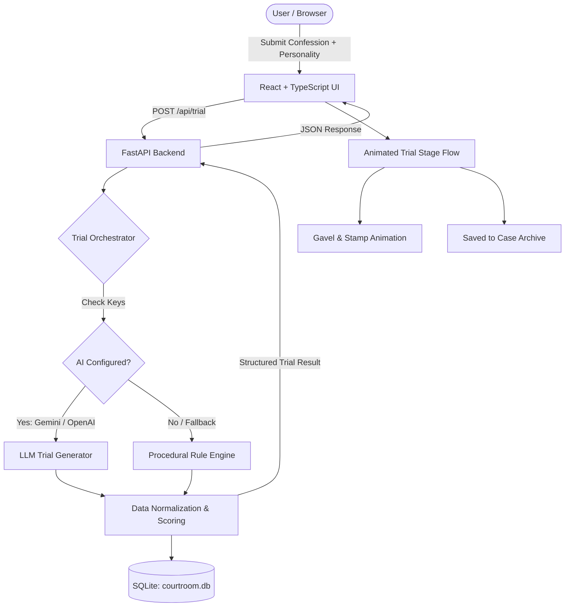

# ⚖️ Courtroom of Stupid Decisions

<div align="center">

```
  ____                  _                              __   ____  _              _     _   ____            _     _
 / ___|___  _   _ _ __ | |_ _ __ ___   ___  _ __ ___    \ \ / / / / /___ _   _  __| |   / | |  _ \  ___  ___(_)___(_) ___  _ __  ___
| |   / _ \| | | | '__|| __| '__/ _ \ / _ \| '_ ` _ \    \ V / / / // __| | | |/ _` |   | | | | | |/ _ \/ __| / __| |/ _ \| '_ \/ __|
| |__| (_) | |_| | |   | |_| | | (_) | (_) | | | | | |    | | / / / \__ \ |_| | (_| |   | | | |_| |  __/ (__| \__ \ | (_) | | | \__ \
 \____\___/ \__,_|_|    \__|_|  \___/ \___/|_| |_| |_|    |_|/_/_/  |___/\__,_|\__,_|   |_| |____/ \___|\___|_|___/_|\___/|_| |_|___/
```

**Where your most embarrassing moments, late-night blunders, and awkward interactions face fictional justice.**

[](https://python.org)
[](https://fastapi.tiangolo.com)
[](https://react.dev)
[](https://www.typescriptlang.org)
[](https://vitejs.dev)
[](https://tailwindcss.com)
[](https://sqlite.org)
[](LICENSE)

[Features](#-key-features) • [Characters](#-the-courtroom-cast) • [Tech Stack](#-technology-stack) • [Quick Start](#-quick-start) • [API Reference](#-api-reference) • [Architecture](#-architecture--data-flow) • [Configuration](#-configuration--environment)

</div>

---

## 📖 Overview

**Courtroom of Stupid Decisions** is an interactive full-stack comedy application that puts your everyday bad decisions on trial.

Whether you:

- Waved back at someone who was actually waving at the person standing behind you,
- Rehearsed an imaginary argument in the shower for 30 minutes and still managed to lose,
- Said _"you too"_ when the movie theater usher handed you your popcorn and told you to enjoy the show, or
- Pretended to understand a joke for 45 awkward minutes rather than admit you didn't get it...

...**Judge Reginald "Randy" Trash-Panda III** and his chaotic courtroom staff are ready to hear the prosecution, review the evidence, dismiss the defense's pathetic excuses, and hand down an absurd, legally non-binding sentence.

> **💡 Zero-Config AI Fallback:**
> The app includes both **AI-driven generation** (Google Gemini & OpenAI) and an extensive **procedural template fallback engine**. You can run and enjoy the full experience completely offline without needing any API keys!

---

## ✨ Key Features

- 🦝 **Unforgiving Raccoon Judge**: Sarcastic, unpredictable, obsessed with shiny objects, prone to falling asleep mid-trial, and fond of handing out bizarre punishments.
- 🎭 **Three Courtroom Personalities**:
  - `Friendly` — The court is weirdly supportive and gives gentle nudges.
  - `Brutally Honest` — Zero mercy, sharp sarcasm, ruthless legal takedowns.
  - `Completely Unhinged` — Pure legal chaos, irrelevant tangents, and trash-can justice.
- 🏷️ **Automated Crime Classification**: Classifies confessions into categories like _Social Embarrassment_, _Procrastination_, _Questionable Texting_, _Unnecessary Overthinking_, _Petty Revenge_, _Academic Disaster_, and _General Stupidity_.
- 📊 **Stupidity Severity Meter (1–10)**: Dynamic scoring that measures the magnitude of the infraction and determines the verdict category.
- 🔍 **Exhibit Evidence Generation**: Uncovers incriminating Exhibit items (e.g., Exhibit A: _The Incident Report_, Exhibit B: _Deleted Drafts & Incognito Searches_, Exhibit C: _Awkward Silence Logs_).
- ⚔️ **Interactive Argument Duel**:
  - **Prosecution**: Vicky Overkill treats your blunder like the trial of the century.
  - **Defense**: Greg Bumble tries his best, but accidentally incriminates you with every argument.
- ⚡ **Random Courtroom Events**: Objections to sandwiches, surprise nap recesses, missing documents, and self-sabotaging objections.
- 🔨 **Dramatic Animated Verdict Stamps**: Oversized stamped verdicts (`GUILTY`, `MOSTLY GUILTY`, or `NOT GUILTY`) with custom animation effects.
- 📜 **Absurd Sentences**: "Sentenced to re-live this exact moment at 3 AM every night for the next five years."
- 📁 **Case Archive & History**: Persistent SQLite database storing full case records, verdicts, dates, and severity ratings with one-click deletion and case review.
- 🎲 **"Confess a Random Crime" Button**: Instant inspiration button pulling hilarious confessions if your own memory goes blank.

---

## 👥 The Courtroom Cast

| Character                                     | Role                     | Profile & Personality                                                                                                                                                              |
| --------------------------------------------- | ------------------------ | ---------------------------------------------------------------------------------------------------------------------------------------------------------------------------------- |
| **Judge Reginald "Randy" Trash-Panda III** 🦝 | **Presiding Judge**      | Sarcastic raccoon in judicial robes. Loves shiny objects, regularly takes 20-minute recesses to chase pen caps, occasionally eats evidence, and issues disproportionate sentences. |
| **Victoria "Vicky" Overkill** ⚔️              | **Prosecuting Attorney** | Treats every awkward text and mild procrastination like treason. Slams manila folders with "GOTCHA" written in red sharpie. Frequently objects to defendants existing.             |
| **Greg Bumble, Esq.** 🛡️                      | **Defense Attorney**     | Heart is in the right place; legal competence is nowhere to be found. Routinely enters his own grocery list as Exhibit B and accidentally proves the prosecution's point.          |

---

## ⚖️ Crime Categories & Verdicts

### Categories

- 😳 **Social Embarrassment** — Public tripping, wave mishaps, misheard greetings.
- ⏰ **Procrastination** — Starting 10-page essays 45 minutes before submission.
- 📱 **Questionable Texting** — Double-texting paragraphs, risky late-night messages, leaving moms on read.
- 🧠 **Unnecessary Overthinking** — Constructing 14 doom scenarios based on one period in a text.
- 😈 **Petty Revenge** — Passive-aggressive refrigerator note wars, malicious compliance.
- 📚 **Academic Disasters** — Cramming entire syllabi on the bus ride to the exam.
- 🤦 **General Stupidity** — All other inexplicable decisions defying human logic.

### Verdict Scale

```
Severity:   [ 1 ────── 3 ]       [ 4 ────── 6 ]       [ 7 ────── 10 ]
Verdict:     NOT GUILTY          MOSTLY GUILTY            GUILTY
Consequence: Suspicious Mercy    Probation & Chores    Eternal Cringe
```

---

## 🛠️ Technology Stack

### Backend

- **Framework**: [FastAPI](https://fastapi.tiangolo.com/) (Python 3.11+)
- **ASGI Server**: [Uvicorn](https://www.uvicorn.org/) with hot reloading
- **ORM & Database**: [SQLAlchemy 2.0](https://www.sqlalchemy.org/) with [SQLite](https://sqlite.org/)
- **Data Validation**: [Pydantic v2](https://docs.pydantic.dev/) & `pydantic-settings`
- **AI Integrations**: [Google Generative AI](https://ai.google.dev/) (Gemini Flash) & [OpenAI](https://openai.com/) (GPT-4o / GPT-3.5)
- **Image Generation / Cards**: [Pillow (PIL)](https://python-pillow.org/)

### Frontend

- **Framework**: [React 19](https://react.dev/) + [TypeScript](https://www.typescriptlang.org/)
- **Bundler & Dev Server**: [Vite 8](https://vitejs.dev/)
- **Styling**: [Tailwind CSS v4](https://tailwindcss.com/) + Custom Design System (`index.css`)
- **Icons**: [Lucide React](https://lucide.dev/)
- **HTTP Client**: [Axios](https://axios-http.com/)

---

## 🏛️ Architecture & Data Flow



---

## 📁 Repository Structure

```
Courtroom of Stupid Decisions/
├── README.md                  # Complete project documentation
├── file.md                    # Original concept design & feature spec
├── start.ps1                  # PowerShell one-click dev environment launcher
│
├── backend/                   # Python FastAPI Backend
│   ├── main.py                # App entrypoint, CORS & startup events
│   ├── config.py              # Pydantic Settings & environment variables
│   ├── database.py            # SQLAlchemy models & database session setup
│   ├── schemas.py             # Pydantic models for API request/response validation
│   ├── courtroom.db           # SQLite database file (auto-generated)
│   ├── requirements.txt       # Python dependencies
│   ├── .env.example           # Environment template
│   ├── .env                   # Local secrets (API keys)
│   │
│   ├── engine/                # The Trial Generation Engine
│   │   ├── orchestrator.py    # Coordinates AI + template fallback + normalization
│   │   ├── ai_generator.py    # Gemini & OpenAI prompt execution & JSON parsing
│   │   └── templates.py       # Deterministic keyword classification & procedural jokes
│   │
│   └── routers/
│       └── trials.py          # REST API endpoints (/api/trial, /api/cases, etc.)
│
└── frontend/                  # React + TypeScript Frontend
    ├── package.json           # Frontend dependencies & scripts
    ├── vite.config.ts         # Vite bundler configuration
    ├── index.html             # HTML entry point with custom typography
    │
    └── src/
        ├── main.tsx           # React root renderer
        ├── App.tsx            # Main shell, view state switcher, top navigation
        ├── index.css          # Burgundy & Gold courtroom theme, animations, stamps
        ├── api.ts             # Axios API client functions
        ├── types.ts           # Shared TypeScript interfaces & types
        │
        └── components/
            ├── ConfessionForm.tsx  # Confession input, personality radio, random button
            ├── TrialView.tsx       # Multi-stage trial view, evidence, arguments, stamps
            └── CaseHistory.tsx     # Case archive, severity chips, delete & inspect
```

---

## 🚀 Quick Start

### Prerequisites

- **Python**: 3.10+ (Check with `python --version`)
- **Node.js**: 18+ (Check with `node --version`)
- **PowerShell** (Windows) or **Bash** (macOS / Linux)

---

### Option A: One-Click Launch (Windows PowerShell)

Run the included automated launch script from the root folder:

```powershell
.\start.ps1
```

This will automatically open two windows:

- 🟢 **Backend**: `http://localhost:8000`
- 🟢 **Frontend**: `http://localhost:5173`
- 📘 **Swagger UI**: `http://localhost:8000/docs`

---

### Option B: Manual Setup

#### 1. Backend Setup

```bash
# Navigate to the backend directory
cd backend

# (Recommended) Create and activate a virtual environment
python -m venv venv

# Windows:
.\venv\Scripts\activate
# macOS/Linux:
# source venv/bin/activate

# Install dependencies
pip install -r requirements.txt

# Create your .env file
copy .env.example .env    # On Windows
# cp .env.example .env    # On macOS/Linux

# Start the FastAPI server
uvicorn main:app --reload --port 8000
```

The backend server is now listening at **`http://localhost:8000`**.

#### 2. Frontend Setup

Open a second terminal window:

```bash
# Navigate to the frontend directory
cd frontend

# Install npm packages
npm install

# Start Vite dev server
npm run dev
```

The application is now accessible at **`http://localhost:5173`**.

---

## ⚙️ Configuration & Environment

The backend reads settings from `backend/.env`. A template is provided in `backend/.env.example`:

```ini
# ==========================================
# Courtroom of Stupid Decisions Config
# ==========================================

# Choose your AI provider: "gemini" or "openai"
AI_PROVIDER=gemini

# Option A: Google Gemini (Free API Key available at https://aistudio.google.com)
GEMINI_API_KEY=your_gemini_api_key_here
AI_MODEL=gemini-1.5-flash

# Option B: OpenAI (https://platform.openai.com)
OPENAI_API_KEY=your_openai_api_key_here
# AI_MODEL=gpt-4o-mini

# Application Settings
DATABASE_URL=sqlite:///./courtroom.db
CORS_ORIGINS=["http://localhost:5173","http://localhost:3000"]
```

> [!NOTE]
> **No API Key? No Problem.**
> If `GEMINI_API_KEY` and `OPENAI_API_KEY` are left blank, the app **automatically and silently routes all requests through the built-in procedural engine**. Trials, evidence, and verdicts will still generate instantaneously!

---

## 📡 API Reference

When the backend is running, full interactive OpenAPI documentation is available at:

- **Swagger UI**: `http://localhost:8000/docs`
- **ReDoc**: `http://localhost:8000/redoc`

### Primary Endpoints

| Method   | Endpoint                 | Description                             | Sample Request / Param                                    |
| -------- | ------------------------ | --------------------------------------- | --------------------------------------------------------- |
| `POST`   | `/api/trial`             | Submit a confession and trigger a trial | `{"confession": "...", "personality": "brutally_honest"}` |
| `GET`    | `/api/cases`             | Retrieve paginated case archive         | `?skip=0&limit=20`                                        |
| `GET`    | `/api/cases/{case_id}`   | Retrieve full trial details for a case  | `case_id: "550e8400-..."`                                 |
| `DELETE` | `/api/cases/{case_id}`   | Dismiss and purge a case from archive   | `case_id: "550e8400-..."`                                 |
| `GET`    | `/api/confession/random` | Generate a random confession string     | _None_                                                    |
| `GET`    | `/api/health`            | Health check and server status          | _None_                                                    |

---

### Sample Request & Response

#### Request:

`POST /api/trial`

```json
{
  "confession": "I waved back enthusiastically at a stranger who was actually waving at their dog behind me.",
  "personality": "brutally_honest"
}
```

#### Response (`200 OK`):

```json
{
  "id": "e6a2fc51-09df-4b72-a169-0e70ca2b0693",
  "confession": "I waved back enthusiastically at a stranger who was actually waving at their dog behind me.",
  "category": "social_embarrassment",
  "personality": "brutally_honest",
  "judge_name": "Judge Reginald 'Randy' Trash-Panda III",
  "prosecutor_name": "Victoria 'Vicky' Overkill",
  "defense_name": "Greg Bumble, Esq.",
  "evidence": [
    {
      "title": "The Over-Extended Arm",
      "description": "Witness testimony confirms the wave had a full 180-degree radius of unearned confidence.",
      "exhibit_label": "Exhibit A"
    },
    {
      "title": "The Fake Hair-Tuck Transition",
      "description": "CCTV footage reveals defendant transitioned immediately into pretending to scratch their neck for 40 seconds.",
      "exhibit_label": "Exhibit B"
    }
  ],
  "prosecution_arguments": [
    "Your Honor, the defendant stole affectionate body language intended for a golden retriever!",
    "The sheer audacity of assuming you were the most interesting object in a 50-foot radius is criminal."
  ],
  "defense_arguments": [
    "My client is also good at fetching, so technically the wave was 40% applicable!",
    "Your Honor, if waving at dogs is wrong, none of us are truly innocent."
  ],
  "courtroom_events": [
    {
      "type": "objection",
      "character": "Vicky",
      "description": "OBJECTION! Defense is barking up the completely wrong tree!"
    }
  ],
  "verdict": "GUILTY",
  "sentence": "You are sentenced to re-live this exact moment at 3 AM for the next five years.",
  "severity_score": 8,
  "created_at": "2026-10-18T10:45:00Z"
}
```

---

## 🎨 Design Philosophy & Aesthetics

The user interface was crafted with a deliberate visual identity:

- **Courtroom Noir & Parchment Palette**:
  - Background: Deep Judicial Obsidian (`#0d0a0e`) & Burgundy undertones (`#1a0f18`)
  - Accent Metals: Antique Gold (`#c9a227`) and Brass gradients
  - Parchment Accents: Off-white weathered legal paper (`#f4ecd8`)
- **Typography**:
  - Headings: Serif display font (_Cinzel_ / _Playfair Display_)
  - Legal Transcripts: Monospaced typewriter font (_Courier Prime_ / _JetBrains Mono_)
- **Micro-Interactions**:
  - Animated gavel and stamp physics
  - Progressive argument disclosure tab system
  - Stupidity severity progress meters with glow effects
  - Frosted glass cards with warm golden borders

---

## 🧪 Testing & Validation

### Backend Verification

Run unit checks on the trial generation logic:

```bash
cd backend
python -c "from engine.templates import generate_trial_from_templates; print(generate_trial_from_templates('I spilled coffee on my cat', 'unhinged')['verdict'])"
```

### Frontend Typecheck & Build

Validate all TypeScript types and Vite bundle integrity:

```bash
cd frontend
npm run build
```

---

## 🗺️ Roadmap & Future Additions

- [ ] **🖼️ Shareable Graphic Verdict Cards**: Generate branded PNG images of verdicts using Pillow to share directly to Instagram, X (Twitter), and Reddit.
- [ ] **🔊 Audio Effects & Voice Lines**: Sound effects for gavel strikes, objections, paper shuffles, and AI-voiced character dialogue.
- [ ] **👥 Community Jury Mode**: Allow visitors to vote "Guilty" or "Not Guilty" on anonymous community submissions.
- [ ] **⚔️ Multiplayer Court Battles**: Challenge a friend to enter their side of a petty argument and let Judge Randy pick a winner.
- [ ] **🎖️ Offender Badges**: Unlock badges like _Repeat Offender_, _Public Menace_, and _Certified Overthinker_.

---

## 🤝 Contributing

Contributions to the Courtroom are welcome! Here is how you can help:

1. **Fork the Repository**
2. **Create a Feature Branch** (`git checkout -b feature/absurd-sentences`)
3. **Add New Content**:
   - Add new jokes or categories in `backend/engine/templates.py`
   - Add new courtroom events or characters in `backend/schemas.py` & `backend/engine/`
4. **Commit Your Changes** (`git commit -m 'feat: Add 10 new late-night shopping crimes'`)
5. **Push to the Branch** (`git push origin feature/absurd-sentences`)
6. **Open a Pull Request**

---

## ⚖️ Legal Disclaimer

_All trials, charges, verdicts, and sentences generated by this software are purely fictional and intended solely for comedic and entertainment purposes. Judge Reginald "Randy" Trash-Panda III is a raccoon and does not possess a valid state bar license in any jurisdiction. The creators assume no legal liability for any lingering feelings of awkwardness or midnight memories._

---

<div align="center">

Made with 🦝, 🔨, and questionable decisions.

**[Back to Top ↑](#-courtroom-of-stupid-decisions)**

</div>
